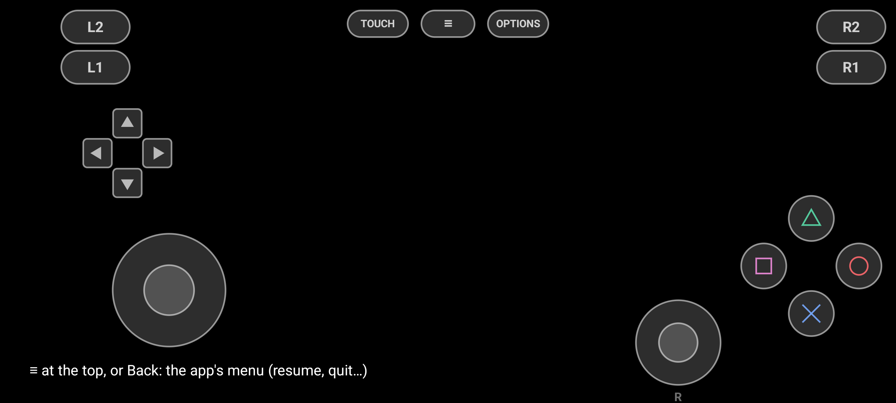

# NBA 2K14 for Android

Play **NBA 2K14 (next-gen, PlayStation 4 version)** offline on Android, from your own copy of the game.

The app is a self-contained launcher around [shadPS4](https://github.com/shadps4-emu/shadPS4), a PlayStation 4
emulator, in its ARM64 build with the [FEX](https://github.com/FEX-Emu/FEX) x86-64 translator. It needs no root,
no Termux and no extra app: install the APK, pick the game folder, play.

*[Version française](README.fr.md)*

> **The game is not included.** You need your own copy of NBA 2K14 for PS4 (CUSA00104), as a decrypted game
> folder. The Xbox One version is not supported. This project is not affiliated with 2K, Visual Concepts or Sony.

## Features

- **Full offline game**: quick matches, MyCAREER and saves, with the game's own menu music in the launcher.
- **Runs on more than one device**: picks a Vulkan driver per GPU (Adreno 6xx to 8xx, Mali experimental), a frame
  rate per chip and screen, and checks the device on a **DEVICE** screen.
- **Gamepad or touch**: Xbox, PlayStation, 8BitDo and built-in gamepads; an on-screen PS4 pad on phones, resizable,
  clear of camera cutouts.
- **Heat aware**: follows Android's thermal state and drops to 30 frames per second while the device is too hot.
- **Saves you keep**: export and import saves as a zip; export logs for bug reports.
- French and English.

## Requirements

- Android 8.0 or newer, 64-bit ARM
- a Qualcomm Adreno 6xx / 7xx / 8xx GPU (Snapdragon), or an ARM Mali Valhall or newer GPU (experimental)
- 12 GB of memory recommended (8 GB at least), about 45 GB of free storage

Tested device: **AYN Odin 3** (Snapdragon 8 Elite): 40 frames per second, full matches. Details and expectations per
chip: [docs/COMPATIBILITY.md](docs/COMPATIBILITY.md).

## Installation

1. Download the APK from the [latest release](../../releases/latest) and install it.
2. Copy your decrypted NBA 2K14 PS4 folder (the one holding `eboot.bin` and `sce_sys`) to the device, for example
   in `Games/`.
3. For sound, put `libSceNgs2.sprx`, the audio module from your own PS4's system software, in that folder.
4. Open the app, choose the folder, check the **DEVICE** screen, and press **PLAY**.

To uninstall or change devices, first export your saves (**SAVES → Export the saves**): Android deletes the app's
data with the app.

## Controls

| | Gamepad | Touch |
|---|---|---|
| App menu (resume, info, quit) | the device's menu key, L3 + R3, or Back | **≡** at the top, or Back |
| Quit the game | Select + Start held for 2 seconds | app menu → Quit the game |
| Button remapping | menu → CONTROLS | — |
| Touch pad size and opacity | — | app menu |

## Building

See [docs/BUILDING.md](docs/BUILDING.md): the engine from [engine/](engine/), the engine package from
[runtime/](runtime/), then the app with `build.sh`. How the parts fit together: [docs/ARCHITECTURE.md](docs/ARCHITECTURE.md).
What was tested and how: [docs/TESTING.md](docs/TESTING.md).

## Licence

GPL-2.0-or-later, as the engine it is built on. See [LICENSE](LICENSE) and
[THIRD-PARTY-NOTICES.md](THIRD-PARTY-NOTICES.md) for the components it includes.

NBA 2K14 is a trademark of Take-Two Interactive Software. PlayStation is a trademark of Sony Interactive
Entertainment. This project does not contain or distribute any of their software or content.
