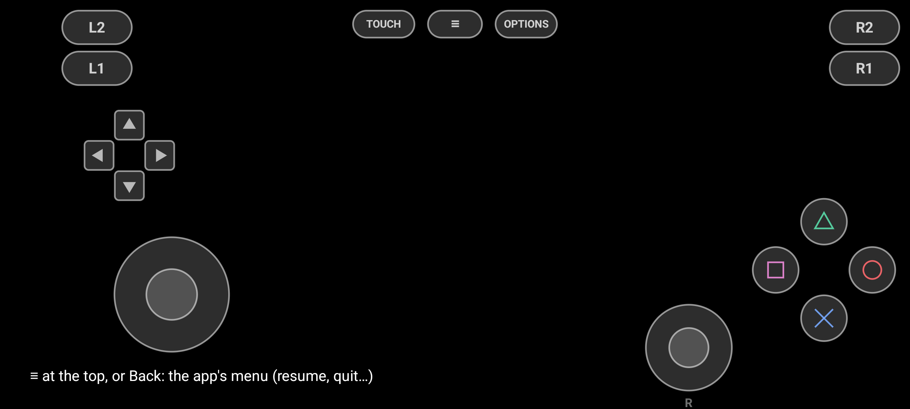
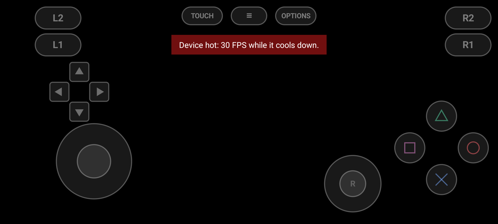

# Testing

## On a device

The reference device is an **AYN Odin 3** (Snapdragon 8 Elite, Adreno 830, 12 GB, 120 Hz), where full matches,
saves and reloads, sound and gamepad were played through during development.

## On an Android emulator

What matters on other devices (driver choice, the DEVICE report, the on-screen pad, the heat watch) was tested on
an Android 14 emulator (Pixel 7 profile, 2400 × 1080 with a camera cutout, plus tablet
2560 × 1600 and small 1600 × 720 screens). The engine itself can't run there (no Adreno or Mali GPU), so the test
build's `sans-moteur` and `gpu-essai.txt` switches stand in for it (see [BUILDING.md](BUILDING.md#test-builds)).

| Checked | How | Result |
|---|---|---|
| Install and start on a generic arm64 system | emulator's ARM translation | menu opens (this found and fixed a crash on processors without ARMv8.1 atomics) |
| Game folder picker and file check | a folder with the game's real small files and size-matched empty archives | "Ready to play" |
| DEVICE report | emulator GPU, then pretend Adreno 740, Adreno 619, Mali-G715, Mali-G72 | correct verdict, colours and planned driver for each |
| Default frame rate | 60 Hz screen | 30 selected and marked as recommended |
| Driver and picture settings | taps, saved settings file | cycles through the drivers, saved |
| Game failing to start | engine can't run on the emulator | the reason is shown on the menu (this found and fixed a message that vanished with the game's process) |
| On-screen pad | captured the UDP pad packets during taps and swipes | Cross, left stick (gradual), L2 with full trigger, release to centre |
| Pad layout | 20:9 with cutout, large and small sizes, faint and bold | clear of the cutout; this found and fixed an overlap of the D-pad and L1 at the large size |
| Heat watch | `cmd thermalservice override-status` 3, 0, 4 | 30 FPS banner, removed after a minute cool, "very hot" warning |
| Release build | the test switches present on the device | ignored |

## Not covered yet

The game itself on other GPUs than the Adreno 830 (in particular the Turnip 7xx and PanVK drivers), and Bluetooth
gamepads other than the Odin's built-in one. Reports are welcome: **SAVES → Export the log** in the app.
